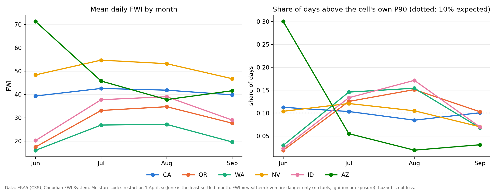

# Western US Wildfire Hazard Assessment (ERA5 Fire Weather Index)

A reproducible Python pipeline that builds a **wildfire hazard layer** for six Western US states from 22 years (2001–2022) of ERA5 reanalysis, using the **Canadian Fire Weather Index (FWI) system**. The hazard layer is benchmarked against the Copernicus CEMS fire-danger reanalysis and validated against observed wildfire perimeters (NIFC).


## Key results

| Check | Result |
|---|---|
| Benchmark vs Copernicus CEMS fire-danger reanalysis | **r = 0.99** for daily FWI over 12.8 M fire-season cell-days |
| Trend in extreme fire-weather days (Theil–Sen / Mann–Kendall) | **+5.7 to +7.1 days/decade** in CA, OR and WA (p < 0.01) |
| Hazard vs observed burned area (NIFC, ~238,000 km²) | State-year **Spearman ρ = 0.64** (p < 0.01, robust to detrending) |
| Hazard ranking skill | Top-20% hazard cell-years captured **37%** of burned area |

## Method

1. **Data:** ERA5 hourly 2 m temperature, 2 m dewpoint (relative humidity), 10 m wind and precipitation at 0.25°, fire season (April–September), 2001–2022.
2. **Fire Weather Index:** daily FFMC, DMC, DC, ISI, BUI and FWI computed with the Canadian FWI system.
3. **Benchmark:** daily FWI compared with the Copernicus CEMS fire-danger reanalysis; residual bias traced to moisture-code start-up.
4. **Hazard metrics:** days above local P90/P95 FWI thresholds, monthly seasonality and Theil–Sen / Mann–Kendall trends.
5. **Validation:** hazard compared with NIFC wildfire perimeters at state-year and grid-cell level (rank correlation, detrended check and a gain curve).

## Figures

| Benchmark vs CEMS | Hazard vs burned area |
|---|---|
|  |  |

| Seasonality | Gain curve |
|---|---|
|  |  |

## Repository structure

```
src/
  01_download_era5.py            # download ERA5 inputs from the Copernicus CDS
  01b_download_cems_fwi.py       # download CEMS fire-danger reanalysis (EWDS)
  02_extract_and_validate.py     # extract the study region and check the inputs
  03_compute_fwi.py              # compute the FWI system
  04_benchmark_cems.py           # benchmark against CEMS
  05_hazard_climatology.py       # exceedance, seasonality and trend metrics
  06a_download_fire_perimeters.py# download NIFC wildfire perimeters
  06_fire_overlay.py             # validate hazard against burned area
  map_utils.py                   # shared mapping helpers
  diagnose_era5_file.py          # quick inspection of an ERA5 file
figures/                         # output figures
requirements.txt
```

## How to run

```bash
python -m venv .venv
source .venv/bin/activate
pip install -r requirements.txt
```

- **ERA5 (CDS):** put your API key in `~/.cdsapirc` ([CDS API setup](https://cds.climate.copernicus.eu/how-to-api)).
- **CEMS (EWDS):** set an environment variable: `export EWDS_API_KEY="<your token>"`.

Then run the scripts in `src/` in numerical order. Raw data (about 1.5 GB) is not stored in this repo; the download scripts recreate it in `data/`.

## Data sources

- ERA5 reanalysis: Copernicus Climate Change Service (C3S), Climate Data Store
- Fire danger indices historical data: Copernicus Emergency Management Service (CEMS), Early Warning Data Store
- Wildfire perimeters: National Interagency Fire Center (NIFC), WFIGS Interagency Perimeters

## Author

**Raghav Shukla**, atmospheric scientist (natural-hazard and weather-risk analytics) · [LinkedIn](https://www.linkedin.com/in/raghav-shukla-917513229/)
