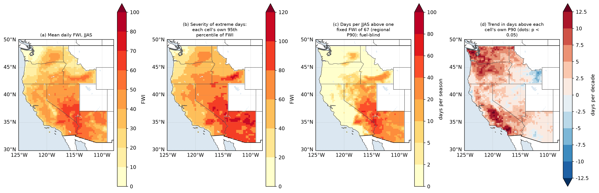
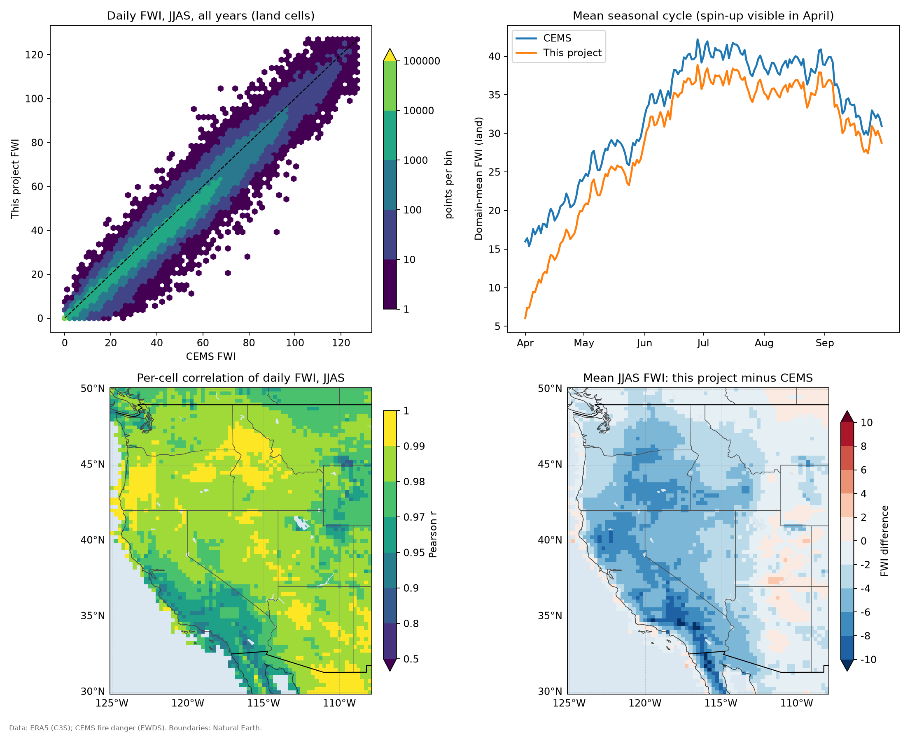
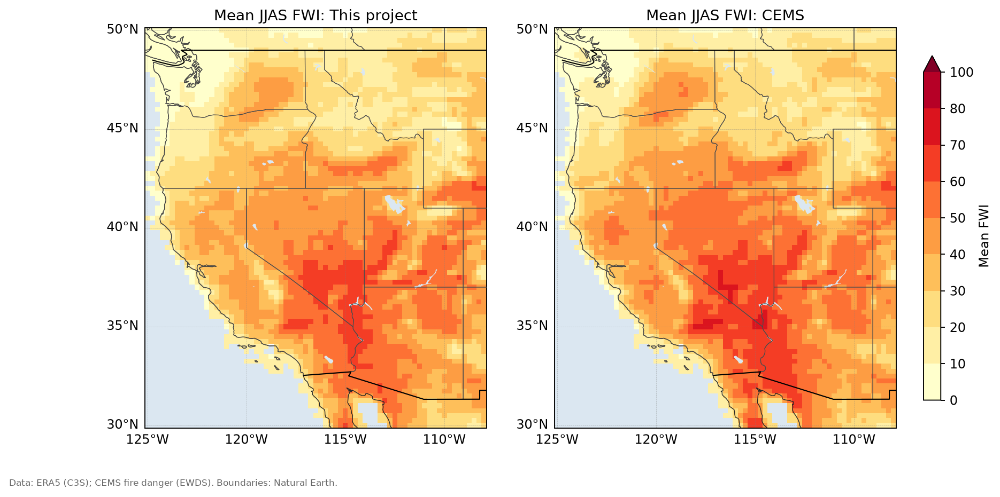
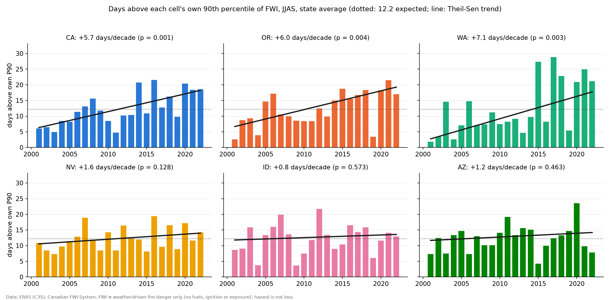
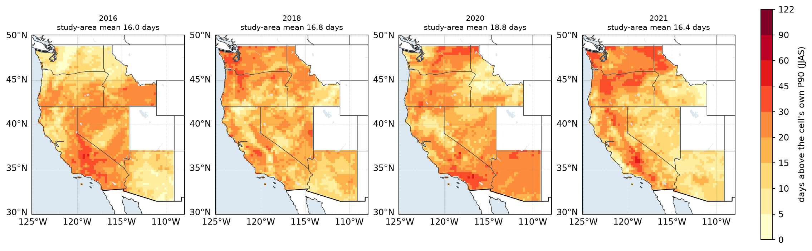
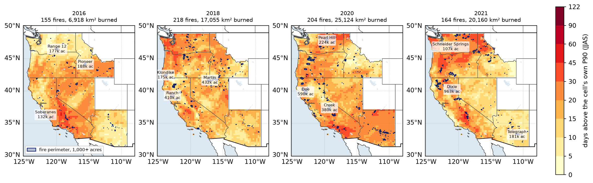
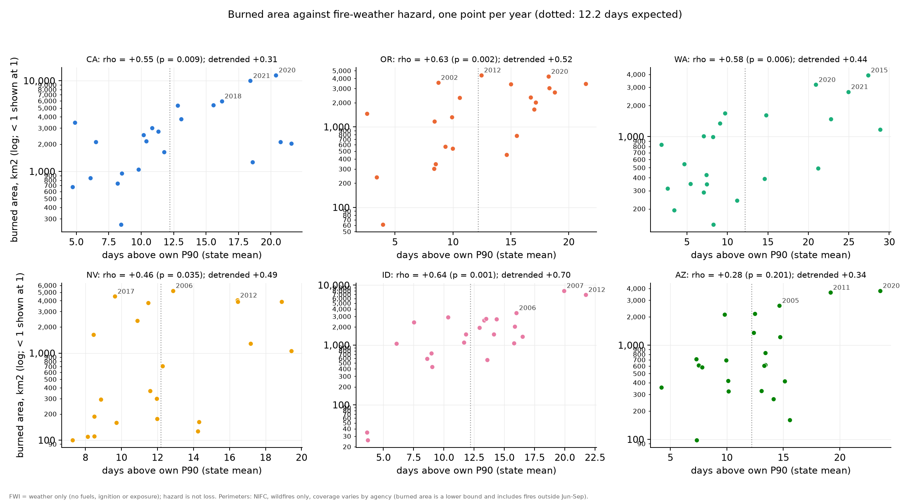
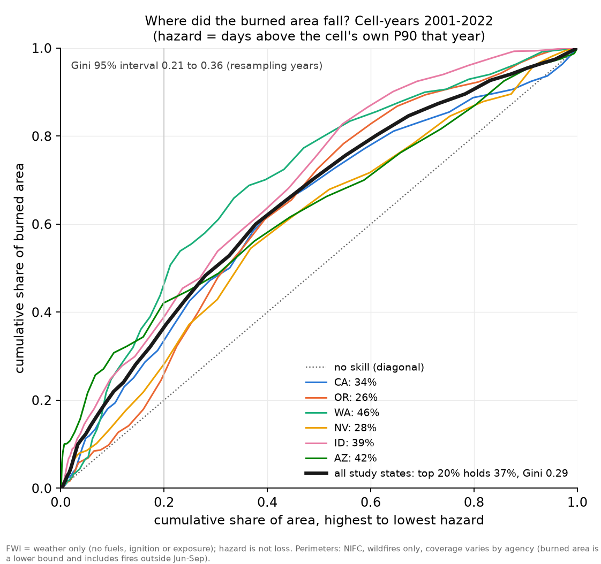

# Western US Wildfire Hazard Assessment (ERA5 Fire Weather Index)

A reproducible Python pipeline that builds a **weather-driven wildfire hazard layer** for six Western US states (**CA, OR, WA, NV, ID, AZ**) from 22 years (2001–2022) of ERA5 reanalysis, using the **Canadian Fire Weather Index (FWI) system**. The hazard layer is benchmarked against the Copernicus CEMS fire-danger reanalysis and validated against observed wildfire perimeters from NIFC.



## Results at a glance

| Check | Result |
|---|---|
| Benchmark vs Copernicus CEMS | **r = 0.99** for daily FWI over 12.8 M fire-season cell-days |
| Trend in extreme fire-weather days | **+5.7 to +7.1 days/decade** in CA, OR and WA (p < 0.01) |
| Hazard vs burned area (NIFC, ~238,000 km²) | State-year Spearman **ρ = 0.28–0.64** across the six states; positive in all six after detrending |
| Hazard ranking skill | Top-20% hazard cell-years hold **37%** of burned area (Gini 0.29, 95% interval 0.21–0.36) |

## Method

1. **Inputs:** ERA5 2 m temperature, 2 m dewpoint, 10 m wind and hourly precipitation at 0.25° (about 28 km), 1 April – 30 September, 2001–2022. Daily FWI inputs are taken at 20:00 UTC (early afternoon local time), with 24-hour rain ending at that time.
2. **Fire Weather Index:** daily FFMC, DMC, DC, ISI, BUI and FWI computed with the Van Wagner & Pickett (1985) equations. Moisture codes start each year on 1 April (FFMC 85, DMC 6, DC 15); April–May act as spin-up, so the analysis uses **June–September (JJAS)**.
3. **Benchmark:** every FWI component compared with the CEMS historical fire-danger dataset.
4. **Hazard indicator:** for every grid cell, the number of JJAS days per year above **that cell's own 90th/95th FWI percentile**. FWI ignores fuel, so deserts score high on the raw scale; counting days relative to each cell's own climate removes that bias. Trends use Theil–Sen slopes with Mann–Kendall significance.
5. **Validation:** NIFC wildfire perimeters (history layer 2001–2019, WFIGS 2020–2022) rasterised to the ERA5 grid and compared with the hazard at state-year level (rank correlation, raw and detrended) and cell-year level (gain curve).

## Results in detail

### 1. The computed FWI matches the operational CEMS product



- Daily FWI agrees with CEMS at **r = 0.99** over 12.8 million land cell-days (top left). Per-cell correlations are mostly 0.97–0.99+ across the domain (bottom left).
- This project's FWI runs slightly lower than CEMS, typically 2–6 FWI units and up to about 10 in southern California (bottom right). The seasonal cycle (top right) shows why: CEMS runs continuously, while this pipeline restarts the moisture codes on 1 April. The gap is largest in April and narrows through the summer, but the slow-responding codes (DMC, DC) keep part of the start-up offset.
- The spatial pattern of mean summer FWI is the same in both products, with the highest values in the desert Southwest:



### 2. Where fire weather is most severe, and why a local threshold is needed

In the hazard maps at the top:
- **(a) and (b):** mean and 95th-percentile FWI are highest over Nevada, Arizona and south-east California, the hottest and driest areas.
- **(c):** counting days above one fixed FWI value (67) puts almost all the hazard in the desert Southwest. That is the "fuel-blind" problem: deserts have extreme fire weather but little to burn.
- **(d):** using each cell's own P90 instead shows where fire weather is getting **more extreme relative to local normal**. The strongest increases are in western Washington and Oregon and in central and southern California.

### 3. Extreme fire-weather days are increasing in the Pacific states



| State | Trend (days/decade) | p-value |
|---|---|---|
| CA | +5.7 | 0.001 |
| OR | +6.0 | 0.004 |
| WA | +7.1 | 0.003 |
| NV | +1.6 | 0.128 |
| ID | +0.8 | 0.573 |
| AZ | +1.2 | 0.463 |

By construction, each cell averages 12.2 days per season above its own P90 over the full period. In California, Oregon and Washington, recent seasons regularly exceed 15–25 days, while the interior states show no significant trend. Twenty-two years is a short record, so this describes the period; it is not climate-change attribution.

### 4. The fire season peaks at different times across the region


- **Arizona** peaks in **June**: 30% of its extreme days fall in June, then drop sharply in July, consistent with the onset of the North American Monsoon.
- **Oregon, Washington and Idaho** peak in **July–August**.
- **California** and **Nevada** stay high through the whole season.

### 5. Extreme seasons line up with major fire years



The most extreme seasons averaged 16–19 days above P90 across the study area (2020: 18.8 days), against 12.2 expected. Overlaying NIFC perimeters (1,000+ acres) for the same years shows the large fire seasons of 2018 (17,055 km² burned), 2020 (25,124 km²) and 2021 (20,160 km², including the Dixie Fire at about 963,000 acres):



### 6. The hazard indicator has real skill in explaining burned area



Years with more extreme fire-weather days burn more area in every state:

| State | Spearman ρ | Detrended ρ |
|---|---|---|
| CA | 0.55 (p = 0.009) | 0.31 |
| OR | 0.63 (p = 0.002) | 0.52 |
| WA | 0.58 (p = 0.006) | 0.44 |
| NV | 0.46 (p = 0.035) | 0.49 |
| ID | 0.64 (p = 0.001) | 0.70 |
| AZ | 0.28 (p = 0.201) | 0.34 |

The relationship survives detrending, so it is not just two upward trends lining up.



Ranking every cell-year from highest to lowest hazard, the **top 20% of cell-years contain 37% of all burned area**, against 20% for a no-skill ranking (Gini 0.29, 95% interval 0.21–0.36 from resampling years). Skill is highest in Washington (46%) and Arizona (42%), and lowest in Oregon (26%).

## Limitations

- **Hazard is not loss.** FWI describes weather only: no fuels, ignition, suppression, exposure or vulnerability.
- FWI was developed for Canadian forests; here it is used as a weather-based hazard indicator, not a validated US fire-danger rating.
- One afternoon snapshot per day at 0.25° resolution; moisture codes restart every 1 April.
- Perimeter coverage varies by agency, so burned area is a lower bound. It also includes fires outside June–September, such as wind-driven autumn fires.
- A correlation is not proof of cause.

## Repository structure

```
src/
  01_download_era5.py             # download ERA5 inputs from the Copernicus CDS
  01b_download_cems_fwi.py        # download the CEMS fire-danger reanalysis (EWDS)
  02_extract_and_validate.py      # check the ERA5 files before any science
  03_compute_fwi.py               # compute the FWI system
  04_benchmark_cems.py            # benchmark against CEMS
  05_hazard_climatology.py        # exceedance, seasonality and trend metrics
  06a_download_fire_perimeters.py # download NIFC wildfire perimeters
  06_fire_overlay.py              # validate hazard against burned area
  map_utils.py                    # shared mapping helpers
  diagnose_era5_file.py           # quick inspection of an ERA5 file
figures/                          # output figures (*_smooth.png = contour display versions)
requirements.txt
```

## How to run

```bash
python -m venv .venv
source .venv/bin/activate
pip install -r requirements.txt
```

- **ERA5 (CDS):** put your API key in `~/.cdsapirc` ([CDS API setup](https://cds.climate.copernicus.eu/how-to-api)).
- **CEMS (EWDS):** set an environment variable: `export EWDS_API_KEY="<your token>"`.

Run the scripts in `src/` in numerical order. Most scripts have a `--selftest` option to check their maths. Raw data (about 1.5 GB) is not stored in this repo; the download scripts recreate it in `data/`.

## Data sources

- ERA5 reanalysis: Copernicus Climate Change Service (C3S), Climate Data Store
- Fire danger indices historical data: Copernicus Emergency Management Service (CEMS), Early Warning Data Store
- Wildfire perimeters: National Interagency Fire Center (NIFC), Interagency Fire Perimeter History and WFIGS
- State boundaries: Natural Earth

**Reference:** Van Wagner, C.E. and Pickett, T.L. (1985). *Equations and FORTRAN program for the Canadian Forest Fire Weather Index System.* Forestry Technical Report 33, Canadian Forestry Service.

## Author

**Raghav Shukla**, atmospheric scientist (natural-hazard and weather-risk analytics) · [LinkedIn](https://www.linkedin.com/in/raghav-shukla-917513229/)
